# Sigen PV Monitor

Lokalny podgląd instalacji fotowoltaicznej z magazynem energii **Sigenergy (SigenStor / falownik hybrydowy)**:
przepływy mocy na żywo, liczniki energii, prognoza produkcji, ceny energii z PSE, sprawność falownika
i pełna lista odczytów – w przeglądarce, na komputerze i telefonie w sieci domowej.

> Nieoficjalny projekt open source, **niezwiązany z Sigenergy**. Aplikacja **tylko odczytuje** dane
> z falownika (Modbus TCP, funkcje 0x03/0x04) – niczego w nim nie zmienia.

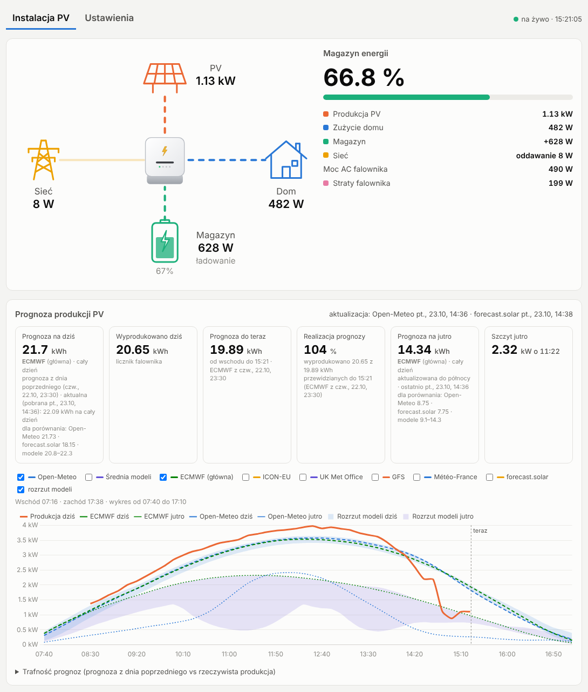

Więcej zrzutów ekranu: [galeria](#zrzuty-ekranu).

## Co potrafi

- **Na żywo:** PV, dom, magazyn (SOC), sieć, moc AC falownika i straty przetwarzania – co 5 s, z animowanym schematem.
- **Dzień:** liczniki energii z falownika (produkcja, zużycie, pobór i oddanie do sieci, ładowanie/rozładowanie),
  autokonsumpcja, samowystarczalność, wykres mocy, tabela godzinowa, historia dowolnego dnia.
- **Prognoza produkcji** na dziś i jutro dla każdej połaci dachu:
  - Open-Meteo (6 modeli pogodowych: ECMWF, ICON-EU, UK Met Office, GFS, Météo-France i automatyczny),
  - forecast.solar,
  - porównanie z rzeczywistą produkcją i tabela trafności prognoz.
- **Realna produkcja każdego stringu PV** (napięcie × prąd) – dzień oraz produkcja w miesiącach (wykres słupkowy z licznika falownika).
- **Ceny energii** co 15 min z PSE (RCE, SDAC) z taryfą dystrybucyjną (G11, G12, G13… operatorów Tauron, PGE,
  Enea, Energa, Stoen). Wzór ceny zakupu jest konfigurowalny, a aplikacja wskazuje najtańsze godziny.
- **Temperatura ogniw magazynu** w czasie, z zakresem korzystnym dla ogniw LFP.
- **Opcjonalnie: rekuperator Vallox (seria MV, MyVallox: 096 / 110 / 145 / 245 MV i inne)** – zakładka Rekuperacja po wpisaniu IP i wyborze modelu w Ustawieniach:
  temperatury i sprawność odzysku, CO₂, wilgotność, balans przepływów z automatyczną korektą, obejście wymiennika
  z automatem letniego chłodzenia, nastawa temperatury nawiewu z automatem, wykresy dnia i energia odzyskana.
  Pobór prądu i praca nagrzewnicy z gniazdka Shelly (Gen1/Plus); inny miernik, np. Tuya – patrz `meter.py`.
- **Zaniki sieci (off-grid):** czerwony pasek i tło strony, gdy dom pracuje bez sieci, oraz historia zaników
  (od kiedy, jak długo).
- **Alarmy falownika i instalacji**, w tym **AFCI** (wykrywanie łuku elektrycznego), z historią zmian.
- **Opcjonalnie dla klientów [Pstryka](https://pstryk.pl/):** po wpisaniu klucza API (aplikacja Pstryk → Integracje)
  w zakładce Ustawienia pojawia się licznik operatora (pobór i oddanie, porównanie z licznikami Sigena),
  rzeczywiste koszty dnia i miesiąca z rozbiciem oraz ceny godzinowe Pstryka na wykresie cen.
  Bez klucza dashboard działa jak dotąd.
- **Strategia osobista – symulacja:** godzinowy plan magazynu na dziś i jutro (autokonsumpcja / standby /
  ładowanie z sieci w tanich godzinach) z szacowaną oszczędnością. Tylko obliczenia – nic nie jest wysyłane do falownika.
- **Sprawność falownika** w przedziałach mocy (dzień, 7/30 dni, cała historia).
- **Wszystkie odczyty falownika** (61 rejestrów) i ustawienia (tylko odczyt) z historią zmian.
- Baza **SQLite** – darmowa, wbudowana, nic nie trzeba instalować.
- Wszystkie ustawienia na stronie, w zakładce **Ustawienia**.

## Zrzuty ekranu

| | |
|---|---|
| **Produkcja każdej połaci i w miesiącach**<br>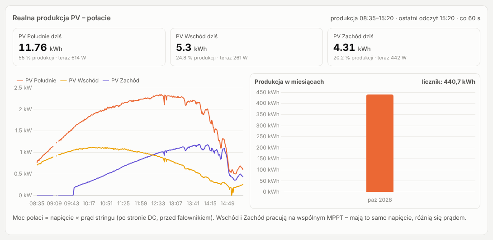 | **Dzień: liczniki, straty, wykres mocy**<br>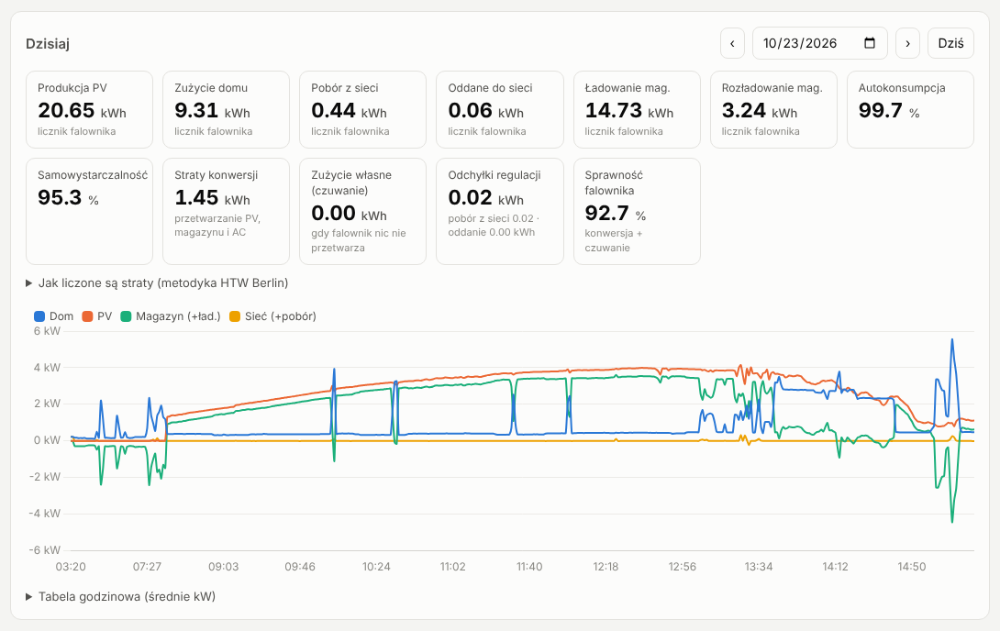 |
| **Ceny energii i strategia magazynu (symulacja)**<br>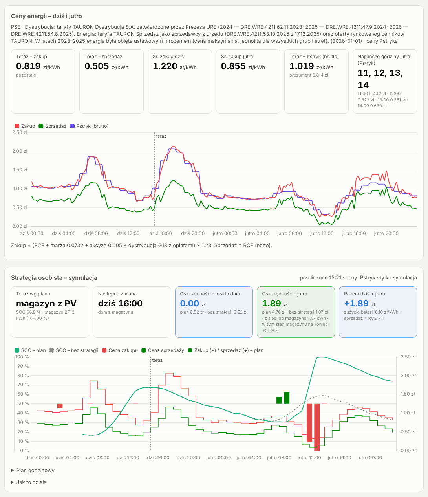 | **Pstryk (opcjonalnie) i sprawność falownika**<br>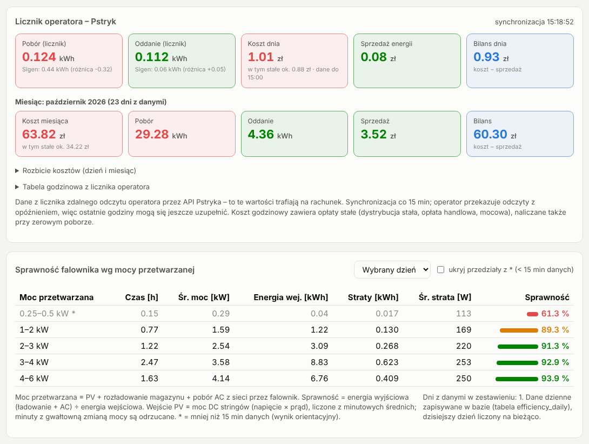 |
| **Alarmy (AFCI), ustawienia falownika, temperatury**<br>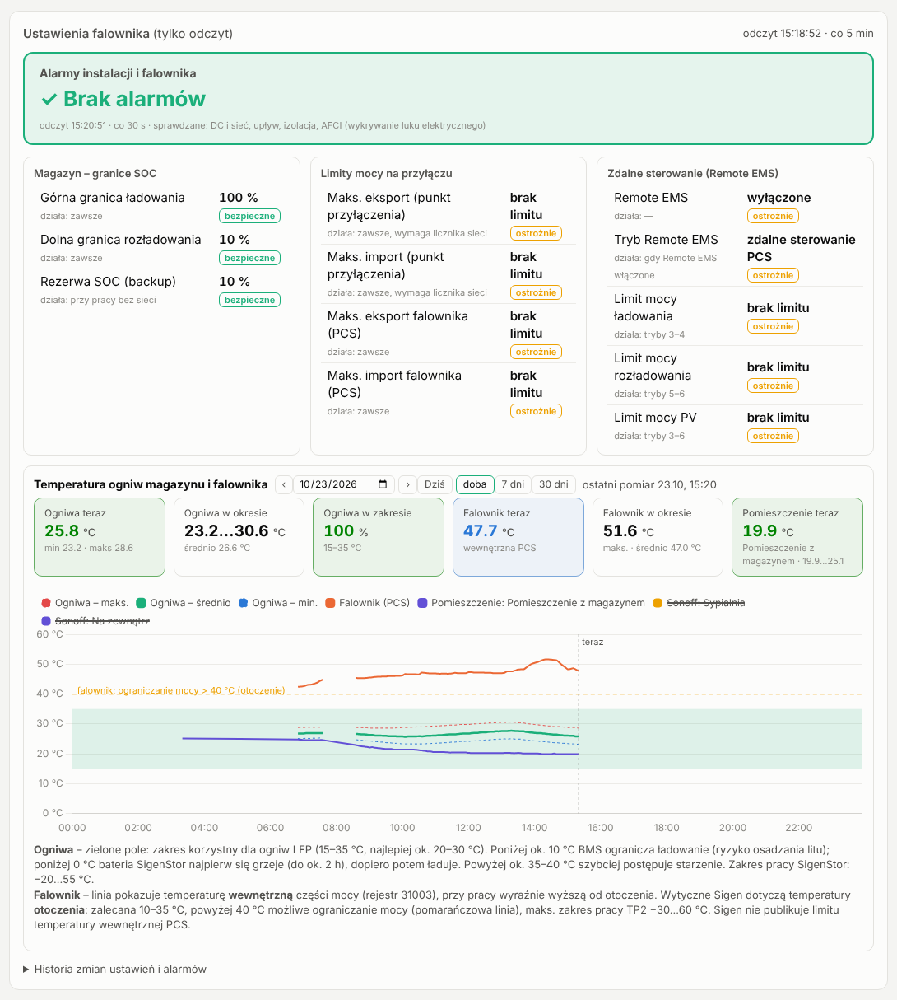 | **Zakładka Ustawienia**<br>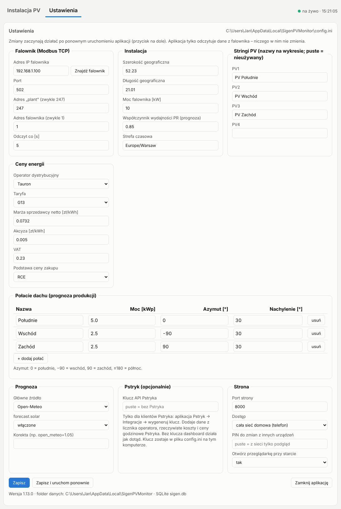 |
| **Zanik sieci – praca wyspowa (off-grid)**<br>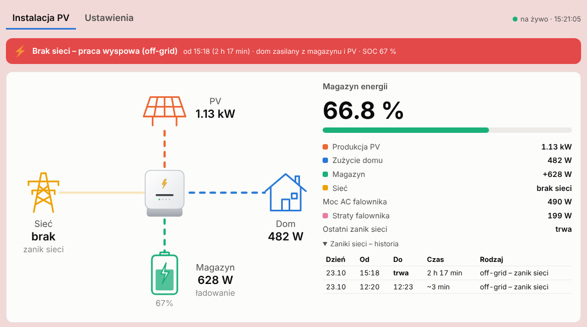 | **Rekuperacja Vallox (opcjonalnie)**<br>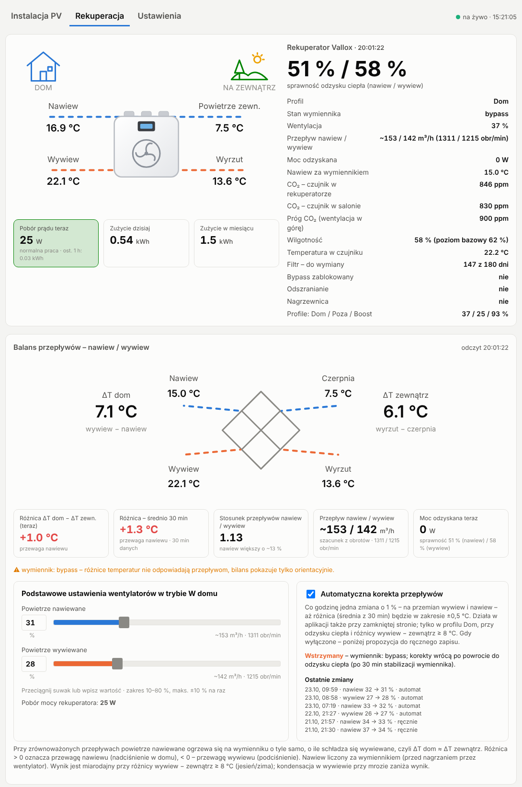 |

**Telefon / aplikacja Android**

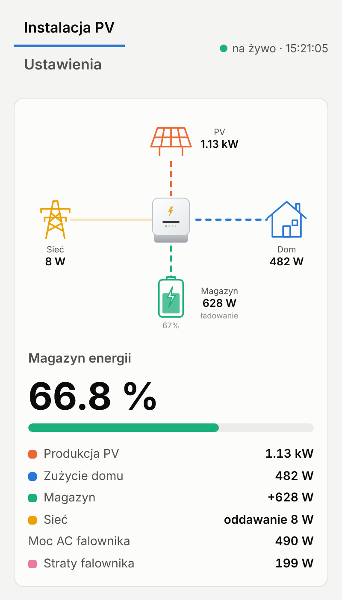

Zrzuty pokazują przykładową instalację (10 kW, 3 połacie, magazyn 27 kWh); numer seryjny i nazwy czujników są zmienione.

## Jak znaleźć adres IP falownika

- przycisk **Znajdź falownik** w zakładce Ustawienia,
- lista urządzeń w panelu routera (DHCP) – nazwa zwykle zaczyna się od „Sigen”,
- informacje o sieci urządzenia w aplikacji mySigen,
- ręcznie: `Test-NetConnection <IP> -Port 502` w PowerShell (`TcpTestSucceeded : True` = Modbus TCP działa).

Warto przypisać falownikowi stały adres w routerze (rezerwacja DHCP).

## Wymagania

- Falownik Sigenergy z włączonym **Modbus TCP** (port 502) w tej samej sieci co komputer. Modbus TCP włącza się
  w aplikacji mySigen albo prosi o to instalatora. Przyda się stały adres IP falownika ustawiony w routerze.
- Windows 10/11 (64-bit). Ze źródeł działa też na Linuksie, macOS i Raspberry Pi.
- Do prognoz i cen potrzebny jest internet. Odczyt z falownika działa lokalnie.

## Instalacja (Windows, bez Pythona)

Pobierz najnowsze wydanie z [Releases](https://github.com/mgrys/Sigen/releases/latest):

| plik | opis |
|---|---|
| `SigenPVMonitor-x.y.z-setup.exe` | instalator: skrót w menu Start, opcjonalny autostart po zalogowaniu, odinstalowanie |
| `SigenPVMonitor-x.y.z-portable.zip` | wersja przenośna: rozpakuj i uruchom `SigenPVMonitor.exe` |

Po uruchomieniu otworzy się przeglądarka z adresem `http://localhost:8000`.

1. Przejdź do zakładki **Ustawienia**.
2. Wpisz adres IP falownika albo kliknij **Znajdź falownik**: program przeszuka sieć domową i sam podpowie adres.
   Potem uzupełnij współrzędne instalacji, połacie dachu i swoją taryfę.
3. Kliknij **Zapisz i uruchom ponownie**.

Przy pierwszym uruchomieniu Windows zapyta o dostęp przez zaporę. Zezwól na sieć prywatną, jeśli chcesz
otwierać stronę z telefonu (`http://<IP-komputera>:8000`).

Instalator ma też opcję **„Uruchamiaj w tle jako usługę Windows”**: program startuje razem z systemem (także bez
logowania) i sam się podnosi po awarii. Wymaga jednorazowej zgody administratora; ustawienia i dane zostają w tym samym
folderze. Usługę zatrzymasz w „Usługach” Windows („Sigen PV Monitor”), a odinstalowanie programu ją usuwa.

Program działa w tle, bez okna. Ponowne kliknięcie skrótu tylko otwiera stronę. Program zamkniesz w zakładce
Ustawienia przyciskiem **Zamknij aplikację**. Żeby dane zapisywały się bez przerwy, komputer musi być włączony.
Dobrze sprawdza się mały komputer, np. mini PC albo Raspberry Pi.

### Telefon i aplikacja Android

Strona działa w całej sieci domowej: na telefonie lub innym komputerze otwórz `http://<IP-komputera>:8000`
(adres IPv4 z polecenia `ipconfig`). Podgląd jest dostępny bez hasła. Zmiany ustawień z innych urządzeń wymagają
**PIN-u**: ustaw go w zakładce Ustawienia → Strona. Bez PIN-u z innych urządzeń działa tylko podgląd. Na komputerze
z aplikacją PIN nie jest potrzebny. Urządzenie jest zapamiętywane po pierwszym wpisaniu PIN-u, a zmiana PIN-u
wylogowuje wszystkie urządzenia.

Aplikacja na Androida (8.0+): pobierz `SigenPV-android-x.y.z.apk` z [Releases](https://github.com/mgrys/Sigen/releases),
zainstaluj (Android zapyta o zgodę na instalację z nieznanego źródła) i podaj adres komputera. Aplikacja wyświetla
ten sam dashboard na pełnym ekranie; adres zmienisz przyciskiem „adres serwera” w stopce strony.
Spoza domu nie otwieraj portu w routerze: użyj VPN, np. Tailscale.

### Gdzie są dane

| wersja | folder z `config.ini`, bazą `sigen.db` i logiem |
|---|---|
| instalator | `%LOCALAPPDATA%\SigenPVMonitor` (skrót w menu Start: „Folder danych i konfiguracji”) |
| przenośna | folder z `SigenPVMonitor.exe` |
| ze źródeł | folder repozytorium |

## Uruchomienie ze źródeł

```bash
git clone https://github.com/mgrys/Sigen.git
cd Sigen
python -m pip install -r requirements.txt
python main.py            # --no-browser, --port 8080
```

Przydatne narzędzia:

- `python tools/sigen_scan.py` – pokazuje, które rejestry udostępnia Twój falownik,
- `python tools/sigen_read.py` – podgląd kilku wartości w konsoli.

## Konfiguracja

Wszystko jest w `config.ini`. Plik tworzy się sam przy pierwszym starcie, a przykład z opisem jest w
[`config.example.ini`](config.example.ini). Najważniejsze sekcje:

| sekcja | co ustawia |
|---|---|
| `[falownik]` | IP, port, adresy Modbus (`plant_id` 247, `inverter_id` 1), częstotliwość odczytu |
| `[instalacja]` | współrzędne, moc falownika, współczynnik PR prognozy |
| `[polacie]` | połacie do prognozy: `nazwa \| kWp \| azymut \| nachylenie` (azymut 0 = południe, −90 = wschód, 90 = zachód) |
| `[stringi]` | nazwy stringów PV1–PV4 na wykresie produkcji (puste = nieużywany) |
| `[ceny]` | operator, taryfa, marża sprzedawcy, akcyza, VAT, podstawa ceny (RCE/SDAC) |
| `[serwer]` | port strony, dostęp z sieci domowej lub tylko z tego komputera |
| `[rekuperacja]` | opcjonalnie: IP rekuperatora Vallox, model, miernik poboru prądu (patrz niżej) |

## Rekuperacja – Vallox seria MV (opcjonalnie)

Zakładka **Rekuperacja** pojawia się po wpisaniu adresu IP rekuperatora w Ustawieniach → Rekuperacja i ponownym
uruchomieniu aplikacji. Bez adresu aplikacja wygląda i działa jak wcześniej.

**Wymagania:** rekuperator Vallox serii MV z MyVallox (096, 110, 145, 245 MV i podobne) w tej samej sieci domowej –
aplikacja łączy się z nim lokalnie (websocket, port 80, bez hasła i bez chmury). Najlepiej ustaw mu stały adres w routerze.

**Ustawienia** (`[rekuperacja]` w `config.ini` albo zakładka Ustawienia):

| ustawienie | znaczenie |
|---|---|
| `vallox_ip` | adres rekuperatora; puste = bez zakładki |
| `model` | `096`, `110`, `145`, `245` albo `inny` – maks. przepływ modelu do szacowania m³/h |
| `przeplyw_max_m3h`, `przeplyw_max_wywiew_m3h` | tylko dla `inny`: maks. przepływ nawiewu i wywiewu z karty katalogowej |
| `obroty_max` | obroty wentylatorów przy 100 %; puste = automatycznie (patrz niżej) |
| `miernik`, `miernik_ip` | gniazdko z pomiarem poboru rekuperatora (`shelly`) – opcjonalnie |
| `nagrzewnica_w` | pobór [W], od którego kafel pokazuje „prawdopodobnie grzałka” (domyślnie 150) |

**Co pokazuje:**

- temperatury: zewnętrzna, nawiew, wywiew, wyrzut, nawiew za wymiennikiem; sprawność odzysku ciepła (nawiew / wywiew),
- profil, stan wymiennika (odzysk ciepła / chłodu, bypass, odszranianie), wentylacja %, CO₂, wilgotność, filtr, nagrzewnica,
- przepływ m³/h i moc odzyskana, energia odzyskana w dniu i miesiącu,
- wykresy dnia (CO₂, sprawność, wilgotność, temperatury, pobór, moc odzyskana) – luki, gdy aplikacja nie działała,
  uzupełniane z wewnętrznego dziennika rekuperatora (co 10 min, ok. 7 tygodni wstecz),
- historia wszystkich zmian (ręcznych i automatów).

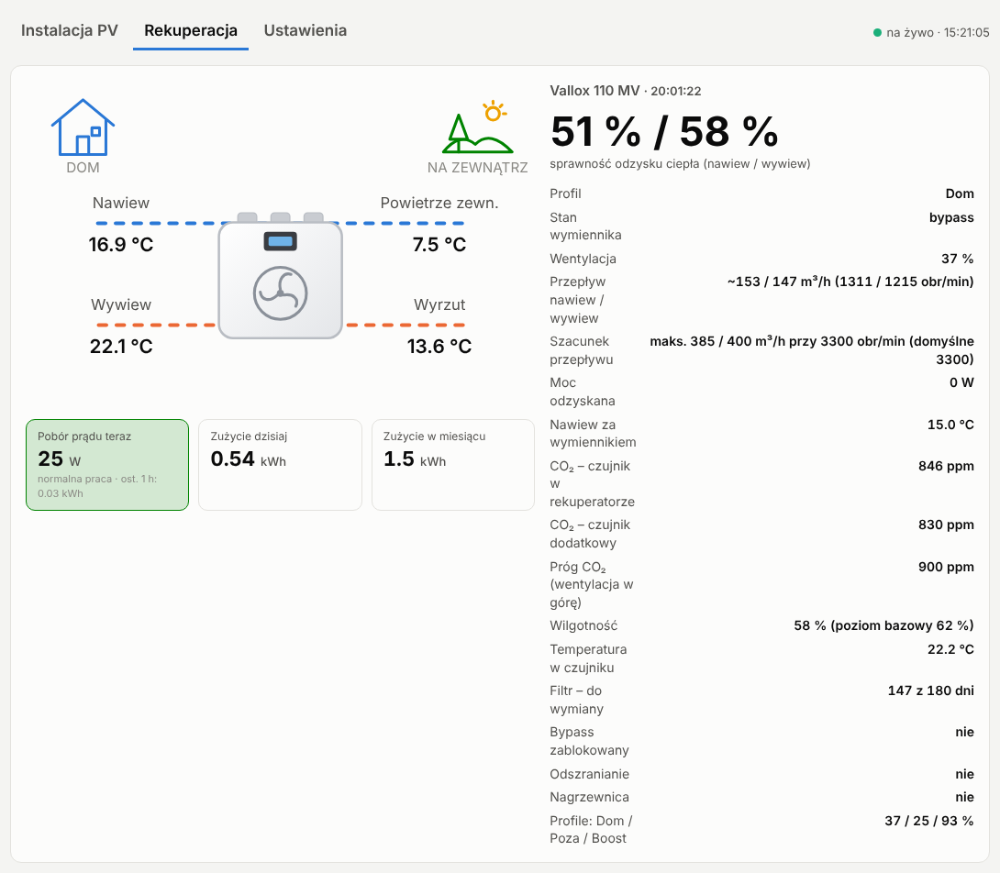

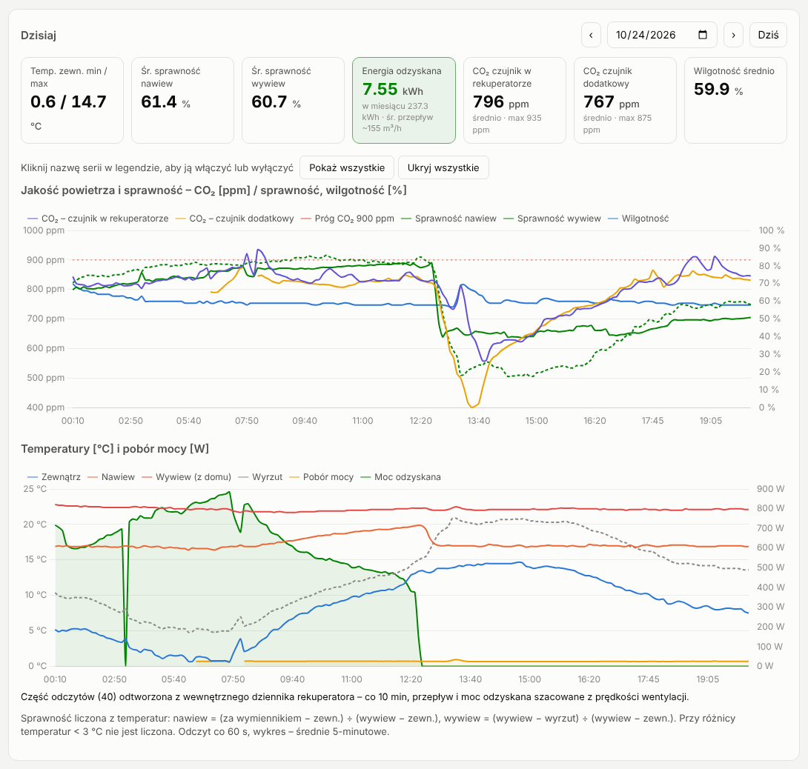

**Przepływ to szacunek.** Seria MV nie mierzy przepływu – aplikacja liczy go z obrotów:
maks. przepływ modelu (dane Vallox przy 100 Pa, osobno nawiew i wywiew) × obroty ÷ obroty przy 100 %.
Obroty przy 100 % aplikacja zapamięta sama, gdy rekuperator popracuje na ≥ 98 % (np. **Boost 100 % przez 2–3 min**);
do tego czasu przyjmuje 3300 obr/min (110 MV). Rzeczywisty przepływ zależy od oporów kanałów w domu – najdokładniejszy
jest pomiar instalatora z protokołu regulacji.

**Sterowanie** – tylko po potwierdzeniu na stronie albo przez włączony automat; z innego urządzenia w sieci wymaga PIN-u.
Każda zmiana jest weryfikowana odczytem i trafia do historii:

- **wentylatory trybu Dom** (nawiew / wywiew osobno, zakres 10–80 %, maks. ±10 % jednym zapisem),
- **obejście wymiennika**: bypass, częściowe obejście, chłodzenie,
- **nastawa temperatury nawiewu** (ta sama w profilach W domu, Poza domem i Boost, 15–25 °C).

**Automaty.** Wykonuje je aplikacja (także przy zamkniętej stronie), każdy włącza się osobno w zakładce Rekuperacja.
Gdy automat jest włączony, odpowiednie przełączniki na stronie są tylko do podglądu; każda jego zmiana trafia do historii
z opisem powodu, a ostatni komunikat („czekam”, „wstrzymany – bypass” itp.) widać przy automacie.

*1. Korekta przepływów (balans nawiew / wywiew)*

Cel: równe przepływy nawiewu i wywiewu – bez nad- i podciśnienia w domu. Przy zrównoważonych przepływach powietrze
nawiewane ogrzewa się na wymienniku o tyle samo, o ile schładza się wywiewane: **ΔT dom (wywiew − nawiew za wymiennikiem)
≈ ΔT zewnątrz (wyrzut − czerpnia)**. Różnica > 0 = przewaga nawiewu, < 0 = przewaga wywiewu.

- pomiar: średnia różnica z ostatnich 30 min (odczyt co 60 s, min. 15 odczytów), liczona dopiero 10 min po każdej zmianie,
- korekta: co godzinę **jedna zmiana o 1 %** podstawowego ustawienia wentylatora trybu Dom, na przemian wywiew i nawiew
  (przewaga nawiewu → wywiew +1 % albo nawiew −1 %, i odwrotnie), w zakresie 10–80 %,
- cel osiągnięty, gdy różnica mieści się w **±0,5 °C** – wtedy bez zmian,
- działa tylko w profilu **Dom**, przy **odzysku ciepła** i różnicy **wywiew − zewnątrz ≥ 8 °C** (latem pomiar jest
  niewiarygodny); bypass i odszranianie wstrzymują automat, a po ich zakończeniu odczekuje 30 min, aż wymiennik się ustabilizuje,
- zabezpieczenie: gdy po 3 kolejnych korektach w tym samym kierunku różnica zamiast maleć rośnie – automat sam się wyłącza
  i opisuje powód (do sprawdzenia ręcznie, np. zatkany filtr albo czerpnia).
- Gdy automat jest wyłączony, strona pokazuje **propozycję** zmiany do zapisania jednym kliknięciem.

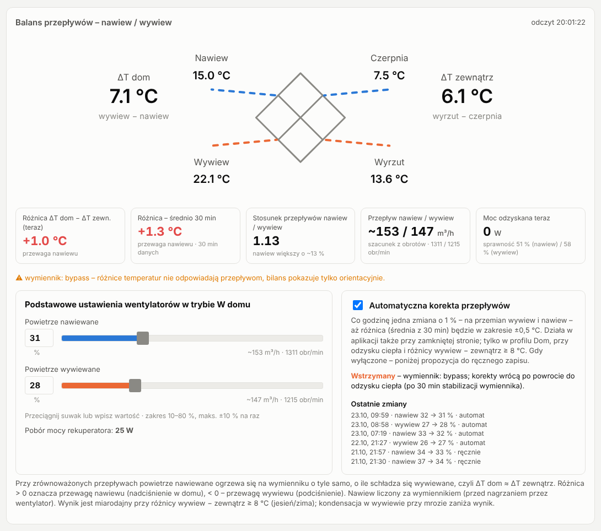

*2. Komfort – letnie chłodzenie (obejście wymiennika)*

Cel: latem nie dogrzewać domu ciepłem z wywiewu, a w chłodne noce chłodzić dom powietrzem z zewnątrz.

- **włącza** obejście wymiennika, częściowe obejście i chłodzenie, gdy wywiew (temperatura w domu) **> komfort + 0,3 °C**
  i na zewnątrz **≥ próg + 0,5 °C**,
- **wyłącza** wszystkie trzy (powrót do odzysku ciepła), gdy wywiew **≤ komfort − 0,3 °C** albo na zewnątrz **< próg**,
- pomiędzy progami (histereza) nic nie zmienia; średnie temperatur z 10 min, zmiana **najwyżej co 30 min**,
- ustawienia: temperatura komfortu (domyślnie **22 °C**, zakres 18–28) i próg temperatury zewnętrznej (domyślnie **5 °C**,
  zakres −10…20) – poniżej progu obejście nie ma sensu (wychłodziłoby dom).

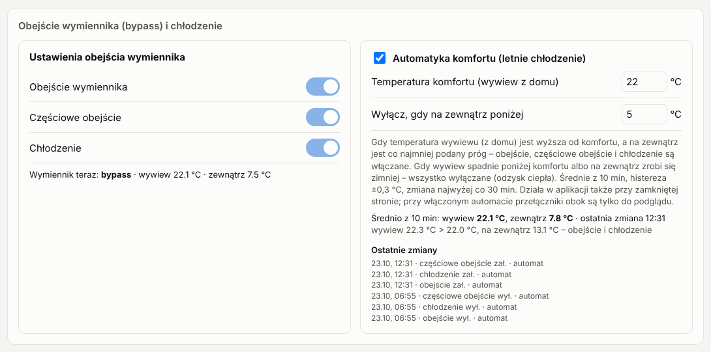

*3. Nastawa temperatury nawiewu (lato / zima / mróz)*

Nastawa to temperatura, do której rekuperator dąży z powietrzem nawiewanym (ta sama w profilach W domu, Poza domem i Boost):
niska chętniej otwiera bypass i chłodzi, wysoka trzyma odzysk ciepła. Automat przestawia ją wg pory roku i temperatur:

| warunek (średnie z 30 min) | nastawa |
|---|---|
| lato (domyślnie maj–wrzesień) i wywiew ≥ **22 °C** | **17 °C** – chłodzenie, bypass w nocy |
| wywiew ≤ **21 °C** (każda pora roku) | **22 °C** – odzysk ciepła |
| między progami | bez zmian (histereza) |
| **mróz**: na zewnątrz ≤ **1 °C** (koniec mrozu przy ≥ 3 °C) i pracuje nagrzewnica | **−1 °C co godzinę**, najniżej **15 °C** |
| koniec mrozu | powrót do nastawy 22 °C |

- w mrozie rekuperator dogrzewa nawiew nagrzewnicą elektryczną – obniżenie nastawy ogranicza jej pracę i zużycie prądu,
- pracę nagrzewnicy rozpoznaje z miernika prądu: średni pobór **≥ 150 W przez ≥ 5 min** bez przerwy (krótkie piki
  kontrolne Vallox są pomijane); bez miernika – z sygnału nagrzewnicy z rekuperatora,
- zmiana najwyżej co 30 min (w mrozie co godzinę); wszystkie progi (miesiące lata, temperatury, nastawy, pobór i czas
  nagrzewnicy, minimum w mrozie) do zmiany na stronie.

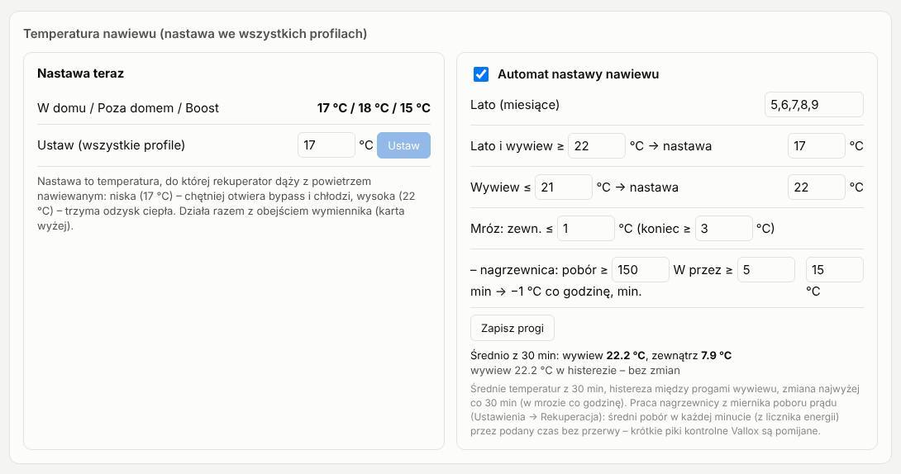

*W przygotowaniu: zewnętrzne czujniki CO₂ (SONOFF AirGuard CO₂, SAWF-08P)*

Planowana jest integracja z czujnikami CO₂ SONOFF SAWF-08P (NDIR, Wi-Fi) rozstawionymi w pokojach: gdy stężenie CO₂
w którymkolwiek pomieszczeniu przekroczy próg (np. 900 ppm), wentylacja zostanie zwiększona, a po spadku – przywrócona.
To uzupełni czujniki CO₂ samego rekuperatora, który mierzy powietrze wywiewane z całego domu, a nie w konkretnym pokoju.
**Ta funkcja jeszcze nie działa** – obecnie aplikacja korzysta tylko z czujników CO₂ podłączonych do Valloxa.

**Pobór prądu rekuperatora (opcjonalnie):** gniazdko Shelly z pomiarem – Gen1 (np. Plug S) i Gen2/Plus/Pro,
rozpoznawane automatycznie. Daje pobór teraz, zużycie i koszt dnia / miesiąca oraz wykrywanie pracy nagrzewnicy
(krótkie piki kontrolne Vallox są pomijane). Bez miernika automat nastawy w mrozie korzysta z sygnału nagrzewnicy
z rekuperatora. **Inny miernik** (Tuya, Tasmota, Home Assistant…) – w nagłówku [`meter.py`](meter.py) jest opis
i przykład dla Tuya: wystarczy jedna funkcja zwracająca moc [W] (i opcjonalnie licznik energii [Wh]).

## Budowanie wersji dla Windows

Wydania buduje GitHub Actions ([`.github/workflows/build.yml`](.github/workflows/build.yml)). Każdy tag `v*`
tworzy wydanie z instalatorem, wersją przenośną i aplikacją Android (`android/`, `gradle -p android assembleRelease`):

```bash
git tag v1.0.0 && git push origin v1.0.0
```

Lokalnie, na Windows:

```powershell
pip install -r requirements.txt pyinstaller
pyinstaller --noconfirm packaging/sigen_pv_monitor.spec          # -> dist\SigenPVMonitor.exe
iscc /DAppVersion=1.0.0 packaging\installer.iss                   # -> dist\SigenPVMonitor-1.0.0-setup.exe (Inno Setup 6)
```

## API

Wszystkie endpointy zwracają JSON, np. do własnych integracji:

- `/api/live`
- `/api/grid_events` (historia zaników sieci)
- `/api/vallox/live`, `/api/vallox/day?date=RRRR-MM-DD`, `/api/vallox/log` (gdy ustawiony rekuperator)
- `/api/day?date=RRRR-MM-DD`
- `/api/forecast`
- `/api/pv_strings`
- `/api/pv_monthly`
- `/api/prices`
- `/api/strategy`
- `/api/pstryk?date=RRRR-MM-DD` (tylko z kluczem API Pstryka)
- `/api/efficiency?days=30`
- `/api/registers`
- `/api/settings`
- `/api/bat_temps?days=1`
- `/api/counters`
- `/api/config`
- `POST /api/discover`

## Uwagi i zgłoszenia

Błędy i pomysły zgłaszaj w [Issues](https://github.com/mgrys/Sigen/issues) albo formularzem na dole strony aplikacji.
Autor: Marek Grys.

## Źródła danych i podziękowania

- [Sigenergy Modbus Protocol](https://www.sigenergy.com/) V2.7: mapa rejestrów.
- [PSE – API raportów](https://api.raporty.pse.pl/): ceny RCE i SDAC.
- [Pstryk – API dla klientów](https://api.pstryk.pl/integrations/swagger/): licznik operatora, koszty i ceny (opcjonalnie).
- [Open-Meteo](https://open-meteo.com/) (CC BY 4.0) i [forecast.solar](https://forecast.solar/): prognozy.
- [polish-electricity-tariffs](https://github.com/davo22/polish-electricity-tariffs): taryfy dystrybucyjne.
- [Chart.js](https://www.chartjs.org/) (MIT), [FastAPI](https://fastapi.tiangolo.com/), [pymodbus](https://github.com/pymodbus-dev/pymodbus).

## Licencja

[MIT](LICENSE). Projekt nieoficjalny. Nazwy Sigenergy i SigenStor należą do ich właścicieli. Korzystasz na
własną odpowiedzialność.
