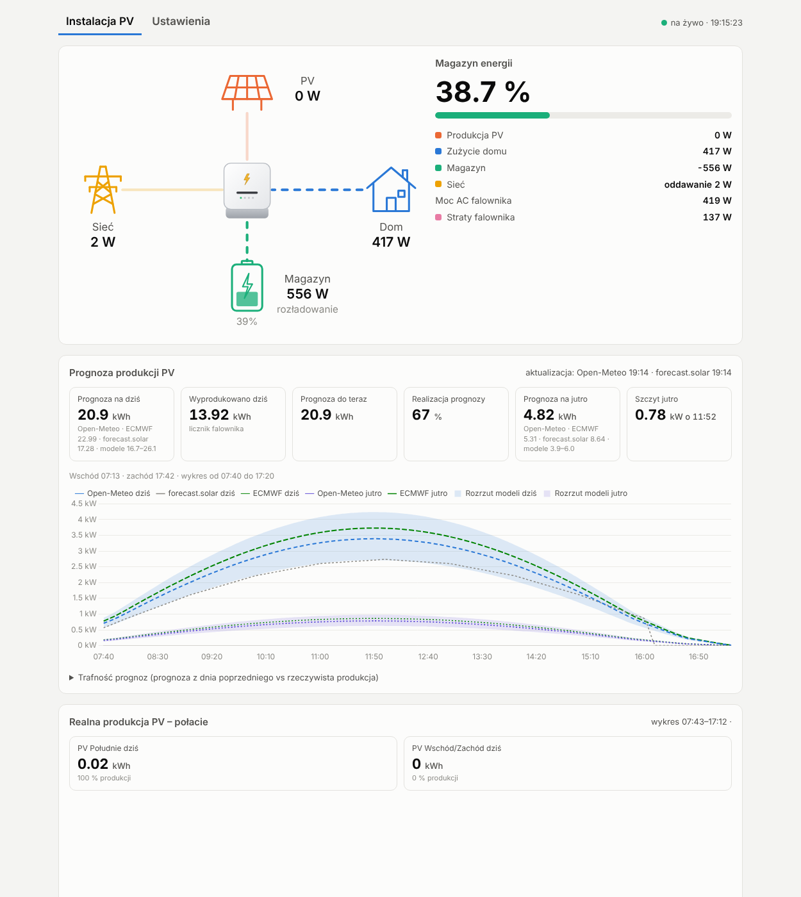

# Sigen PV Monitor

Lokalny podgląd instalacji fotowoltaicznej z magazynem energii **Sigenergy (SigenStor / falownik hybrydowy)**:
przepływy mocy na żywo, liczniki energii, prognoza produkcji, ceny energii z PSE, sprawność falownika
i pełna lista odczytów – w przeglądarce, na komputerze i telefonie w sieci domowej.

> Nieoficjalny projekt open source, **niezwiązany z Sigenergy**. Aplikacja **tylko odczytuje** dane
> z falownika (Modbus TCP, funkcje 0x03/0x04) – niczego w nim nie zmienia.



## Co potrafi

- **Na żywo:** PV, dom, magazyn (SOC), sieć, moc AC falownika i straty przetwarzania – co 5 s, z animowanym schematem.
- **Dzień:** liczniki energii z falownika (produkcja, zużycie, pobór i oddanie do sieci, ładowanie/rozładowanie),
  autokonsumpcja, samowystarczalność, wykres mocy, tabela godzinowa, historia dowolnego dnia.
- **Prognoza produkcji** na dziś i jutro dla każdej połaci dachu:
  - Open-Meteo (6 modeli pogodowych: ECMWF, ICON-EU, UK Met Office, GFS, Météo-France i automatyczny),
  - forecast.solar,
  - porównanie z rzeczywistą produkcją i tabela trafności prognoz.
- **Realna produkcja każdego stringu PV** (napięcie × prąd) – dzień oraz produkcja w miesiącach (wykres słupkowy z licznika falownika).
- **Ceny energii** co 15 min z PSE (RCE, SDAC) z taryfą dystrybucyjną (G11, G12, G13… operatorów Tauron, PGE,
  Enea, Energa, Stoen). Wzór ceny zakupu jest konfigurowalny, a aplikacja wskazuje najtańsze godziny.
- **Temperatura ogniw magazynu** w czasie, z zakresem korzystnym dla ogniw LFP.
- **Alarmy falownika i instalacji**, w tym **AFCI** (wykrywanie łuku elektrycznego), z historią zmian.
- **Opcjonalnie dla klientów [Pstryka](https://pstryk.pl/):** po wpisaniu klucza API (aplikacja Pstryk → Integracje)
  w zakładce Ustawienia pojawia się licznik operatora (pobór i oddanie, porównanie z licznikami Sigena),
  rzeczywiste koszty dnia i miesiąca z rozbiciem oraz ceny godzinowe Pstryka na wykresie cen.
  Bez klucza dashboard działa jak dotąd.
- **Strategia osobista – symulacja:** godzinowy plan magazynu na dziś i jutro (autokonsumpcja / standby /
  ładowanie z sieci w tanich godzinach) z szacowaną oszczędnością. Tylko obliczenia – nic nie jest wysyłane do falownika.
- **Sprawność falownika** w przedziałach mocy (dzień, 7/30 dni, cała historia).
- **Wszystkie odczyty falownika** (61 rejestrów) i ustawienia (tylko odczyt) z historią zmian.
- Baza **SQLite** – darmowa, wbudowana, nic nie trzeba instalować.
- Wszystkie ustawienia na stronie, w zakładce **Ustawienia**.

## Jak znaleźć adres IP falownika

- przycisk **Znajdź falownik** w zakładce Ustawienia,
- lista urządzeń w panelu routera (DHCP) – nazwa zwykle zaczyna się od „Sigen”,
- informacje o sieci urządzenia w aplikacji mySigen,
- ręcznie: `Test-NetConnection <IP> -Port 502` w PowerShell (`TcpTestSucceeded : True` = Modbus TCP działa).

Warto przypisać falownikowi stały adres w routerze (rezerwacja DHCP).

## Wymagania

- Falownik Sigenergy z włączonym **Modbus TCP** (port 502) w tej samej sieci co komputer. Modbus TCP włącza się
  w aplikacji mySigen albo prosi o to instalatora. Przyda się stały adres IP falownika ustawiony w routerze.
- Windows 10/11 (64-bit). Ze źródeł działa też na Linuksie, macOS i Raspberry Pi.
- Do prognoz i cen potrzebny jest internet. Odczyt z falownika działa lokalnie.

## Instalacja (Windows, bez Pythona)

Pobierz najnowsze wydanie z [Releases](https://github.com/mgrys/Sigen/releases/latest):

| plik | opis |
|---|---|
| `SigenPVMonitor-x.y.z-setup.exe` | instalator: skrót w menu Start, opcjonalny autostart po zalogowaniu, odinstalowanie |
| `SigenPVMonitor-x.y.z-portable.zip` | wersja przenośna: rozpakuj i uruchom `SigenPVMonitor.exe` |

Po uruchomieniu otworzy się przeglądarka z adresem `http://localhost:8000`.

1. Przejdź do zakładki **Ustawienia**.
2. Wpisz adres IP falownika albo kliknij **Znajdź falownik**: program przeszuka sieć domową i sam podpowie adres.
   Potem uzupełnij współrzędne instalacji, połacie dachu i swoją taryfę.
3. Kliknij **Zapisz i uruchom ponownie**.

Przy pierwszym uruchomieniu Windows zapyta o dostęp przez zaporę. Zezwól na sieć prywatną, jeśli chcesz
otwierać stronę z telefonu (`http://<IP-komputera>:8000`).

Program działa w tle, bez okna. Ponowne kliknięcie skrótu tylko otwiera stronę. Program zamkniesz w zakładce
Ustawienia przyciskiem **Zamknij aplikację**. Żeby dane zapisywały się bez przerwy, komputer musi być włączony.
Dobrze sprawdza się mały komputer, np. mini PC albo Raspberry Pi.

### Gdzie są dane

| wersja | folder z `config.ini`, bazą `sigen.db` i logiem |
|---|---|
| instalator | `%LOCALAPPDATA%\SigenPVMonitor` (skrót w menu Start: „Folder danych i konfiguracji”) |
| przenośna | folder z `SigenPVMonitor.exe` |
| ze źródeł | folder repozytorium |

## Uruchomienie ze źródeł

```bash
git clone https://github.com/mgrys/Sigen.git
cd Sigen
python -m pip install -r requirements.txt
python main.py            # --no-browser, --port 8080
```

Przydatne narzędzia:

- `python tools/sigen_scan.py` – pokazuje, które rejestry udostępnia Twój falownik,
- `python tools/sigen_read.py` – podgląd kilku wartości w konsoli.

## Konfiguracja

Wszystko jest w `config.ini`. Plik tworzy się sam przy pierwszym starcie, a przykład z opisem jest w
[`config.example.ini`](config.example.ini). Najważniejsze sekcje:

| sekcja | co ustawia |
|---|---|
| `[falownik]` | IP, port, adresy Modbus (`plant_id` 247, `inverter_id` 1), częstotliwość odczytu |
| `[instalacja]` | współrzędne, moc falownika, współczynnik PR prognozy |
| `[polacie]` | połacie do prognozy: `nazwa \| kWp \| azymut \| nachylenie` (azymut 0 = południe, −90 = wschód, 90 = zachód) |
| `[stringi]` | nazwy stringów PV1–PV4 na wykresie produkcji (puste = nieużywany) |
| `[ceny]` | operator, taryfa, marża sprzedawcy, akcyza, VAT, podstawa ceny (RCE/SDAC) |
| `[serwer]` | port strony, dostęp z sieci domowej lub tylko z tego komputera |

## Budowanie wersji dla Windows

Wydania buduje GitHub Actions ([`.github/workflows/build.yml`](.github/workflows/build.yml)). Każdy tag `v*`
tworzy wydanie z instalatorem i wersją przenośną:

```bash
git tag v1.0.0 && git push origin v1.0.0
```

Lokalnie, na Windows:

```powershell
pip install -r requirements.txt pyinstaller
pyinstaller --noconfirm packaging/sigen_pv_monitor.spec          # -> dist\SigenPVMonitor.exe
iscc /DAppVersion=1.0.0 packaging\installer.iss                   # -> dist\SigenPVMonitor-1.0.0-setup.exe (Inno Setup 6)
```

## API

Wszystkie endpointy zwracają JSON, np. do własnych integracji:

- `/api/live`
- `/api/day?date=RRRR-MM-DD`
- `/api/forecast`
- `/api/pv_strings`
- `/api/pv_monthly`
- `/api/prices`
- `/api/strategy`
- `/api/pstryk?date=RRRR-MM-DD` (tylko z kluczem API Pstryka)
- `/api/efficiency?days=30`
- `/api/registers`
- `/api/settings`
- `/api/bat_temps?days=1`
- `/api/counters`
- `/api/config`
- `POST /api/discover`

## Uwagi i zgłoszenia

Błędy i pomysły zgłaszaj w [Issues](https://github.com/mgrys/Sigen/issues) albo formularzem na dole strony aplikacji.
Autor: Marek Grys.

## Źródła danych i podziękowania

- [Sigenergy Modbus Protocol](https://www.sigenergy.com/) V2.7: mapa rejestrów.
- [PSE – API raportów](https://api.raporty.pse.pl/): ceny RCE i SDAC.
- [Pstryk – API dla klientów](https://api.pstryk.pl/integrations/swagger/): licznik operatora, koszty i ceny (opcjonalnie).
- [Open-Meteo](https://open-meteo.com/) (CC BY 4.0) i [forecast.solar](https://forecast.solar/): prognozy.
- [polish-electricity-tariffs](https://github.com/davo22/polish-electricity-tariffs): taryfy dystrybucyjne.
- [Chart.js](https://www.chartjs.org/) (MIT), [FastAPI](https://fastapi.tiangolo.com/), [pymodbus](https://github.com/pymodbus-dev/pymodbus).

## Licencja

[MIT](LICENSE). Projekt nieoficjalny. Nazwy Sigenergy i SigenStor należą do ich właścicieli. Korzystasz na
własną odpowiedzialność.
